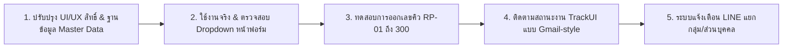

# สรุปผลงานวันนี้ (11 ต.ค. 2026) และแผนงานระบบ FaCiLiTy

เอกสารฉบับนี้สรุปรายการงานที่ดำเนินการสำเร็จทั้งหมดในวันนี้ แบ่งตามหมวดหมู่ พร้อมแผนงานแม่บทและทิศทางการพัฒนาขั้นต่อไป

---

## 📌 หมวดที่ 1: การจัดการสิทธิ์และการแสดงผล (User Permissions & Roles)
* ✅ **จำกัดสิทธิ์บทบาท Teacher (อาจารย์/ผู้ใช้ทั่วไป):**
  * ซ่อนปุ่ม/แท็บ "งานทั้งหมด" เพื่อไม่ให้เห็นงานของผู้อื่น
  * ให้เห็นเฉพาะ **"งานของตัวเอง" (My Tasks)** เท่านั้น
* ✅ **ปรับแต่งเมนูหน้าหลัก:**
  * นำเมนูและกล่อง "มอนิเตอร์ภาพรวม" (Overview Monitor) ออกจากหน้าแรก ให้เหลือเฉพาะเมนูที่จำเป็น

---

## 📌 หมวดที่ 2: เครื่องมือช่วยปฏิบัติงานระบบ (Automated Batch Scripts)
* ✅ **สร้างสคริปต์แบบกดคลิกเดียว 8 ไฟล์ (เฉพาะในเครื่อง ไม่นำขึ้น GitHub):**
  1. `01_deploy_app.bat` - รวมไฟล์ (Build) และส่งขึ้น GitHub อัตโนมัติ
  2. `02_deploy_maintenance.bat` - เปิดโหมดปรับปรุงระบบ (Maintenance Mode)
  3. `02_restore_app.bat` - ปิดโหมดปรับปรุงและคืนหน้าเว็บหลัก
  4. `03_disable_line_group.bat` - ปิดการแจ้งเตือนเข้า LINE กลุ่มหลัก
  5. `04_enable_line_group.bat` - เปิดการแจ้งเตือนเข้า LINE กลุ่มหลัก
  6. `05_backup_system.bat` - สำรองโค้ดทั้งระบบเป็นไฟล์ ZIP เก็บในโฟลเดอร์ backups
  7. `06_start_local_server.bat` - เปิด Web Server จำลองรันในเครื่อง (localhost:3000)
  8. `07_pull_from_github.bat` - ดึงโค้ดล่าสุดจาก GitHub
* ✅ **แก้ไขข้อผิดพลาด Line Endings:**
  * แปลงไฟล์ `.bat` ทั้งหมดเป็น Windows CRLF (`\r\n`) และเข้ารหัส UTF-8 เพื่อแก้ปัญหาตัวชี้คำสั่งหลุดบน Windows CMD

---

## 📌 หมวดที่ 3: ระบบรหัสคิวงานใหม่ (2-Digit Ticket Roll-over)
* ✅ **ปรับโครงสร้างรหัสงานให้สั้นกระชับ:**
  * รูปแบบ: `[รหัสประเภทงาน]-[เลข 2 หลัก]` เช่น `RP-01`, `IT-05`, `AV-12`, `PJ-02`
* ✅ **ระบบวนรอบคิว (Roll-over Queue):**
  * รันได้สูงสุดถึง 300 คิวต่อประเภทงาน (เช่น `RP-01` ถึง `RP-300`)
  * เมื่อครบ 300 จะวนกลับมารันที่ 01 ใหม่อัตโนมัติ
  * หากมีงานถูกลบ เลขคิวจะไม่ดันหรือย้อนกลับ จะรันต่อไปเรื่อยๆ จนกว่าจะมีคำสั่งล้างคิว

---

## 📌 หมวดที่ 4: การวิเคราะห์และจัดทำฐานข้อมูลห้องจริง (Room Master Data)
* ✅ **วิเคราะห์ห้องจริงจากภาพถ่ายตู้กุญแจ 4 รูป:**
  * **ตึก วพบ. (ชั้น 1–4):** รวม 28 รายการ (ห้องเรียน 101–406, ห้องธุรการ, ห้องผู้ช่วย วพบ., ห้องเสื้อผ้า, ห้องอุปกรณ์กีฬา, ห้องน้ำหญิง)
  * **ตึก ศษ. (ชั้น 1–5 + บริการ):** รวม 35 รายการ (สหกรณ์, ห้องเก็บของ, สระว่ายน้ำ, ห้อง 201–508, ห้องประชุม, ห้องพิมพ์ดีด/คอมฯ, ห้อง LAB)
  * **พื้นที่ส่วนกลาง:** 4 รายการ (ป้อมยาม, ลานจอดรถ, โรงอาหาร, สวนหย่อม)
* ✅ **กำหนดรูปแบบมาตรฐานตามที่อนุมัติ:** รูปแบบ `ห้อง 201 (ชั้น 2)`

---

## 📌 หมวดที่ 5: ระบบฐานข้อมูลกลางและการกรองข้อมูล (Master Data & Filtering)
* ✅ **โครงสร้าง Firestore (`master_data`):**
  * จัดเก็บ 4 หมวดหลัก: `locations`, `departments`, `projects`, `mechanics`
* ✅ **อัปเกรดแบบฟอร์มทั้ง 5 หน้า:**
  * เปลี่ยนช่องสถานที่/ห้อง และฝ่าย/แผนก เป็น **Dropdown** ทั้งหมด ผู้ใช้ไม่ต้องพิมพ์เอง
  * มีตัวเลือกสำรอง `➕ อื่นๆ (พิมพ์ระบุเอง)...` กรณีมีจุดเฉพาะกิจ
* ✅ **ระบบกรองข้อมูลแบบ Real-time (Dynamic Filtering):**
  * **หน้า Master Data (`page-master-data`):**
    * เลือกสังกัด (วพบ. / ศษ. / ส่วนกลาง) แล้วรายการข้างล่างจะกรองตามทันที
    * มีแท็บปุ่มลัด `[ทั้งหมด]` `[วพบ.]` `[ศษ.]` `[ส่วนกลาง]` พร้อมแสดงตัวเลขจำนวนห้อง
    * กล่องโครงการ (Projects) กรองตามสังกัดได้แบบเดียวกัน
  * **หน้าแบบฟอร์มแจ้งงาน (Repair, IT, AV, Borrow):**
    * เลือกสังกัด วพบ. -> ดึงเฉพาะห้อง วพบ. + ส่วนกลาง
    * เลือกสังกัด ศษ. -> ดึงเฉพาะห้อง ศษ. + ส่วนกลาง
    * เลือกสังกัด ส่วนกลาง -> ดึงเฉพาะพื้นที่ส่วนกลาง

---

## 📌 หมวดที่ 6: การจัดการผู้ใช้ (User Management)
* ✅ เพิ่มปุ่ม **"ดึงข้อมูลผู้ใช้งานระบบ"** (Migrate จาก Google Sheets มา Firestore)
* ✅ เพิ่มปุ่ม **"ลบผู้ใช้"** ออกจากระบบ Firestore ในหน้าจัดการผู้ใช้งาน

---

## 🗺️ แผนงานและก้าวต่อไป (Roadmap & Next Steps)

1. **เปิดทดสอบหน้างาน:** ให้ผู้ใช้งานจริงทดลองส่งคำขอแจ้งซ่อมผ่าน Dropdown สถานที่ใหม่
2. **ทดสอบความต่อเนื่องของคิว:** สังเกตการณ์ระบบรหัสคิวใหม่เมื่อมีการส่งงานจริง
3. **ปรับแต่งเพิ่มเติม (ตามคำแนะนำของผู้ใช้):** ปรับชื่อห้องหรือเพิ่มแผนก/ฝ่ายเพิ่มเติมได้ตลอดเวลาผ่านหน้า Master Data
